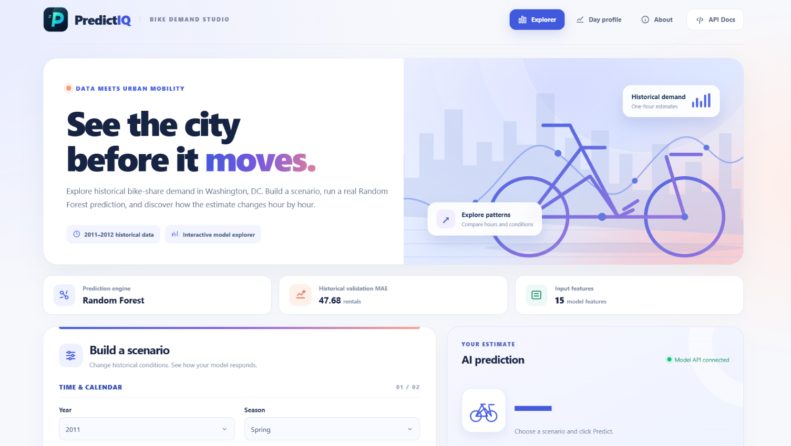
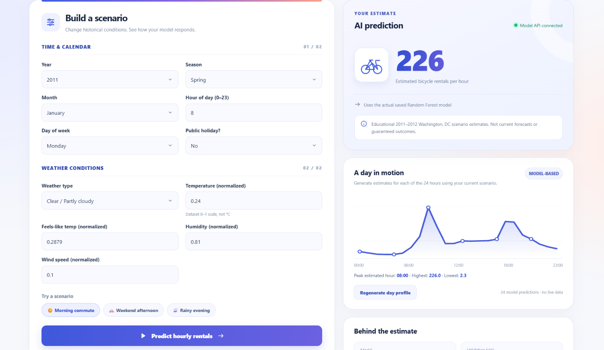
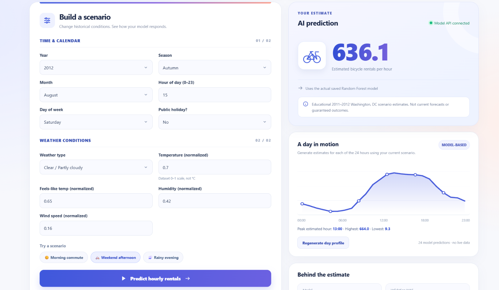
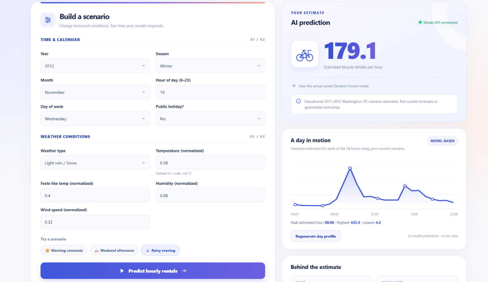
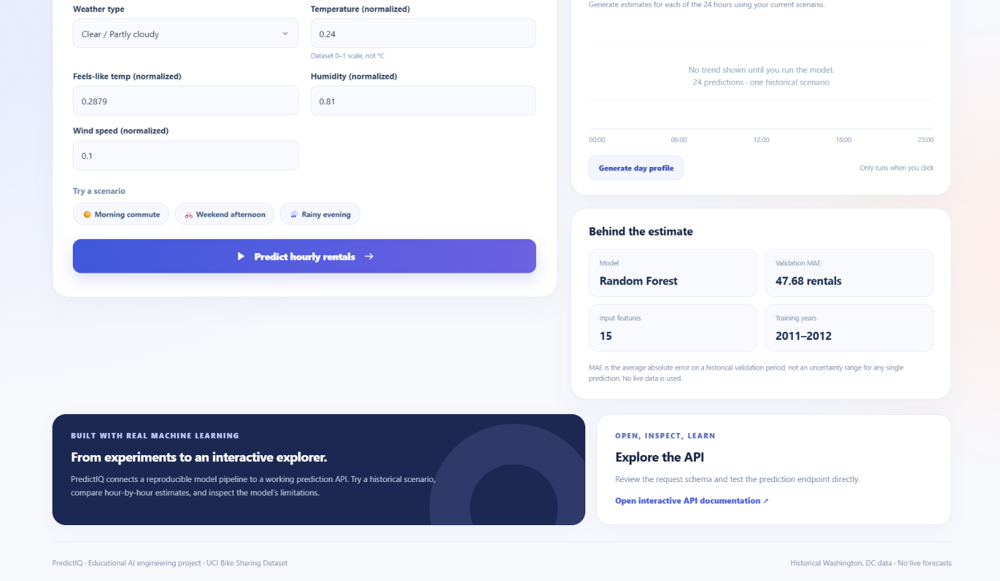
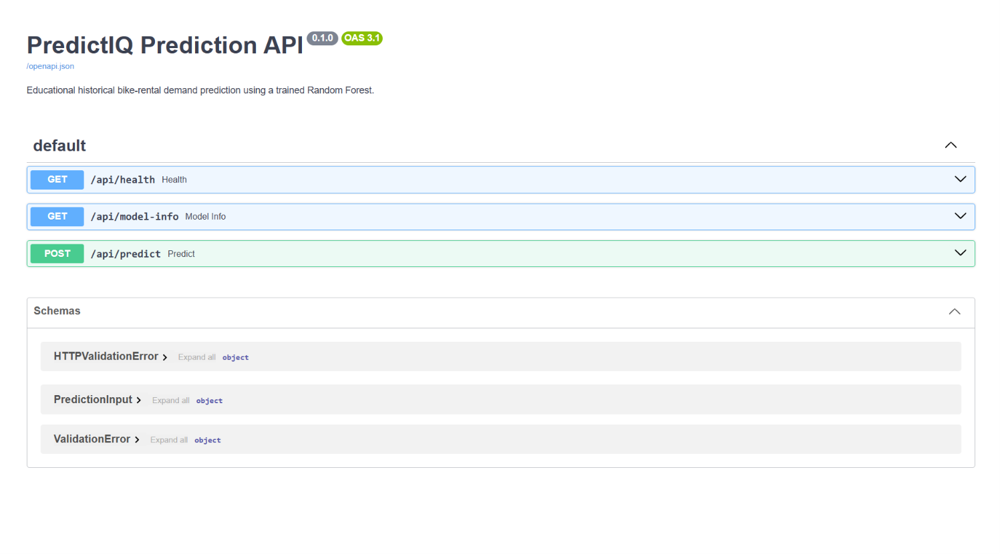

# PredictIQ

### Urban Mobility Demand Intelligence

PredictIQ is an interactive machine learning application that estimates hourly bicycle rental demand using historical weather and calendar conditions.

The application combines a trained Random Forest regression pipeline, a FastAPI backend and a responsive web interface.

## Live Application

- [Open PredictIQ](https://predictiq-iota-plum.vercel.app/)
- [Interactive API Documentation](https://predictiq-iota-plum.vercel.app/docs)
- [Professional Portfolio](https://hasithagayan.github.io/ai-fullstack-87/)

## Application Preview

## Key Features

- Genuine Random Forest model inference
- Interactive weather and calendar inputs
- Morning commute, weekend and rainy evening scenarios
- Hourly bicycle rental demand estimation
- Interactive 24-hour demand visualization
- Validated FastAPI endpoints
- Model evaluation and documented limitations
- Responsive web interface
- Docker and Vercel deployment configurations

## Screenshot Gallery

### Morning Commute

### Weekend Afternoon

### Rainy Evening

### Model Information

### API Documentation

## Model Performance

| Metric | Result |
|---|---:|
| Historical observations | 17,379 |
| Validation MAE | 47.68 rentals |
| Validation RMSE | 74.14 rentals |
| Input features | 15 |
| Recorded automated tests passed | 57 |
| Repeated local container predictions | 30/30 |
| Average local API response time | 71.59 ms |
| Observed local container memory | 234.4 MiB |

Performance measurements are from documented local experiments. Cloud latency may differ.

## Architecture

    UCI Bike Sharing Dataset
              |
        Data Preparation
              |
       Feature Engineering
              |
     Random Forest Pipeline
              |
         FastAPI Backend
              |
      Interactive Frontend
              |
       Vercel Deployment

The project also includes exploratory clustering, neural network and transformer embedding experiments.

## Technology Stack

- Python 3.14
- Scikit-learn
- Pandas
- NumPy
- Joblib
- FastAPI
- Pydantic
- HTML, CSS and JavaScript
- pytest
- Docker
- Vercel

## API Endpoints

| Method | Endpoint | Purpose |
|---|---|---|
| GET | /api/health | Application and model health |
| GET | /api/model-info | Model information |
| POST | /api/predict | Hourly demand estimation |
| GET | /docs | Interactive API documentation |

## Local Installation

Clone the repository:

    git clone https://github.com/HasithaGayan/predictiq.git
    cd predictiq

Create a Python 3.14 virtual environment:

    python -m venv .venv

Activate on Windows:

    .venv\Scripts\activate

Install inference dependencies:

    python -m pip install -r requirements.txt

Start the application:

    python -m uvicorn backend.app:app --host 127.0.0.1 --port 8000

Open:

http://127.0.0.1:8000/

The verified trained model is included in the repository.

## Docker Deployment

    docker build -t predictiq .
    docker run --rm -p 10000:10000 predictiq

Open http://localhost:10000/

## Testing

Install the test dependencies:

    python -m pip install pytest httpx

Run the API tests:

    python -m pytest tests/test_day70_api.py tests/test_day70_failures.py -q

The wider experimental test suite requires the training environment documented in requirements-training.txt.

## Engineering Documentation

- [Data Quality](docs/day63_data_quality.md)
- [EDA and Baseline](docs/day64_eda_baseline.md)
- [Supervised Model Training](docs/day65_model_training.md)
- [Model Improvement](docs/day66_model_improvement.md)
- [Unsupervised Learning](docs/day67_unsupervised.md)
- [Neural Network Experiments](docs/day68_neural_network.md)
- [Embeddings](docs/day69_embeddings.md)
- [Application Verification](docs/day70_demo.md)
- [Model Card](docs/day70_model_card.md)

## Dataset Attribution

Fanaee-T, H. (2013). Bike Sharing Dataset.
UCI Machine Learning Repository.

https://doi.org/10.24432/C5W894

Dataset license: CC BY 4.0.

## Current Limitations

- The model uses historical 2011-2012 Washington, DC bicycle rental data.
- Predictions are educational scenario estimates, not current demand forecasts.
- Final independent held-out evaluation remains pending.
- Individual prediction errors may be substantial.
- Cloud response times and availability may vary.
- No real-time weather or rental data is used.
- Never load untrusted joblib or pickle artifacts.

## Developer

Developed by Hasitha Gayan.

AI and Full-Stack Developer | IT Undergraduate

[GitHub](https://github.com/HasithaGayan) |
[Portfolio](https://hasithagayan.github.io/ai-fullstack-87/)
