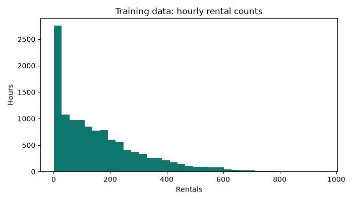
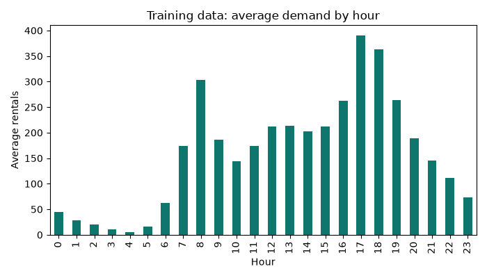
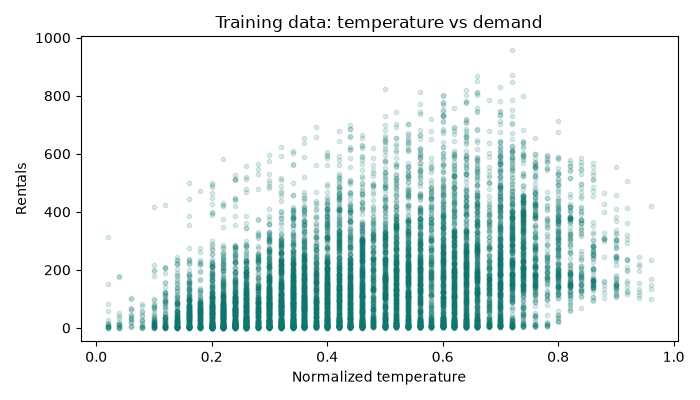
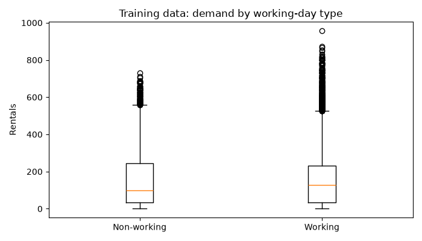

# Day 64 — Exploratory Data Analysis and ML Baseline

## Project
PredictIQ — Urban Mobility Demand Intelligence

## Dataset
UCI Bike Sharing Dataset, 2011–2012.
Prediction target: hourly total rentals (cnt).

## Leakage-Safe Split
Strategy: Chronological; 70/15/15 by complete dates

Training: 12139 rows
Validation: 2640 rows
Held-out test: 2600 rows

Training period: 2011-01-01 to 2012-05-25
Validation period: 2012-05-26 to 2012-09-12
Test period: 2012-09-13 to 2012-12-31

The dataset was split chronologically using whole days.

The held-out test labels were not used for fitting,
baseline selection, plots or validation metrics.

## Baseline
Estimator: DummyRegressor with mean strategy.

Validation MAE: 194.5179
Validation RMSE: 254.6071

The baseline predicts the mean of training targets.
Its predictions do not depend on input features.

The preprocessing pipeline is fitted on training
data only, in preparation for future feature-based models.

## Three Observations from Training Data

1. Highest training mean demand at 17:00: 390.8 rentals/hour.
2. Working-day mean: 162.4; non-working-day mean: 153.9.
3. Training temperature-demand correlation: 0.398.

These findings describe historical training data.
They do not establish causal relationships.

## Three Hypotheses to Test

1. Commuting patterns change hourly peaks on working days.
2. Temperature improves prediction beyond calendar features.
3. Weather severity helps predict demand beyond time features.

## Charts

### Rental Demand Distribution

### Average Hourly Demand

### Temperature and Demand

### Working-Day Comparison

## Data Leakage Prevention

Excluded:
- casual
- registered
- instant

The original training and validation target values
remain separate from the model's input features.

## Next Step
Days 65–66: Train real feature-based ML models,
compare them with this baseline, and investigate
model performance on validation data.

Do not tune using the held-out test period.

## Dataset Credit
Fanaee-T, H. (2013). Bike Sharing [Dataset].
UCI Machine Learning Repository.
https://doi.org/10.24432/C5W894

License: CC BY 4.0.
