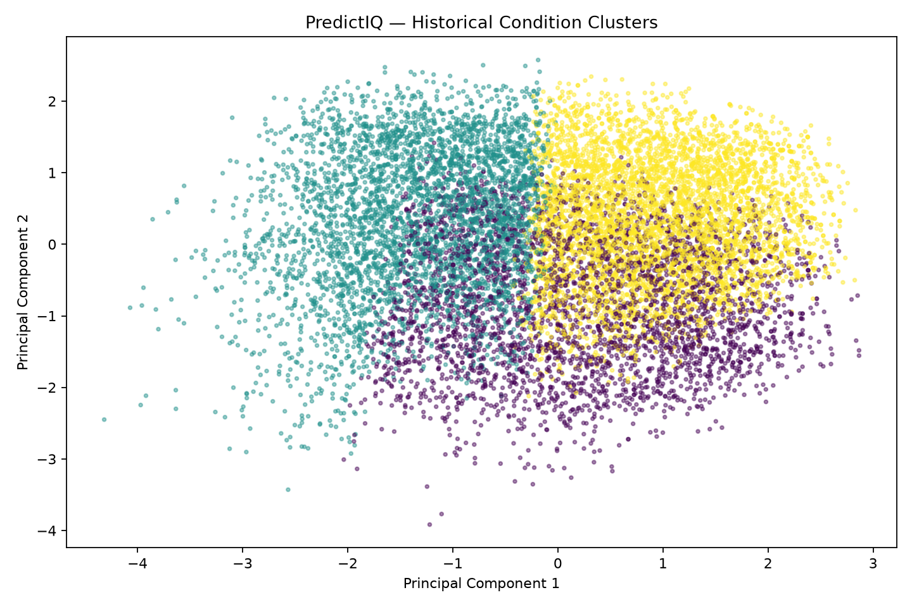

# PredictIQ — Day 67 Unsupervised Learning

## Objective

Explore patterns in historical bike-rental conditions
using K-Means clustering and PCA.

## Dataset

UCI Bike Sharing Dataset, 2011-2012.

Training observations: 12139

Validation observations not used:
2640

Held-out test observations not used:
2600

## Clustering Features

temp, hum, windspeed, hour_sin, hour_cos, workingday

The target cnt was NOT used to fit the clusters.
The casual and registered columns were also excluded.

## Method

1. Load the previously cleaned dataset.
2. Preserve the chronological data split.
3. Select clustering features from training data.
4. Fit StandardScaler on training features.
5. Fit K-Means with three clusters.
6. Apply PCA for two-dimensional visualization.
7. Inspect cluster characteristics afterward.
8. Save the report and visualization.

K-Means random_state: 42
K-Means n_init: 10

## Actual Cluster Results

| Cluster | Rows | Mean hour | Mean temp | Mean humidity | Mean observed rentals |
|---|---:|---:|---:|---:|---:|
| 0 | 3371 | 11.08 | 0.4326 | 0.6515 | 131.1 |
| 1 | 4007 | 14.96 | 0.5359 | 0.4647 | 247.05 |
| 2 | 4761 | 9.04 | 0.435 | 0.7462 | 106.49 |

Observed rental counts are descriptive inspection
results. They were not clustering inputs.

Temperature and humidity are normalized dataset
features, not physical measurement units.

Clusters are not verified real-world categories.

## PCA Results

Principal Component 1: 27.72%

Principal Component 2: 18.47%

Combined explained variance: 46.19%

These percentages describe retained feature variance,
not model prediction accuracy.

PCA is used for visualization.

## PCA Visualization

## Automated Verification

The test suite checks:

- Target leakage prevention.
- Clustering and PCA output generation.
- Preservation of the original input dataset.
- Missing-dataset handling.
- Invalid cluster counts.
- Nonfinite-feature rejection.
- Excessive cluster-count rejection.

## Reproduction

Run from the PredictIQ repository root:

    python -m src.predictiq.day67_unsupervised

Run automated tests:

    python -m pytest tests -v

Generated outputs:

    reports/generated/day67/report.json
    reports/generated/day67/pca_clusters.png

Generated outputs stay local.
A documentation copy of the chart is published.

## Limitations

- Data describes historical 2011-2012 conditions.
- Cluster numbers have no predefined meanings.
- PCA does not establish useful predictions.
- The two PCA components lose some information.
- Clustering patterns do not establish causation.
- Clustering has not been independently validated
  for a real operational decision.
- Modern rental demand performance is unknown.

## Next

Day 68: PyTorch neural-network fundamentals.

Day 69: Embeddings and transformer fundamentals.

Day 70: Evaluated ML/FastAPI proof application.

## Dataset Attribution

Fanaee-T, H. (2013).
Bike Sharing Dataset.
UCI Machine Learning Repository.
https://doi.org/10.24432/C5W894
