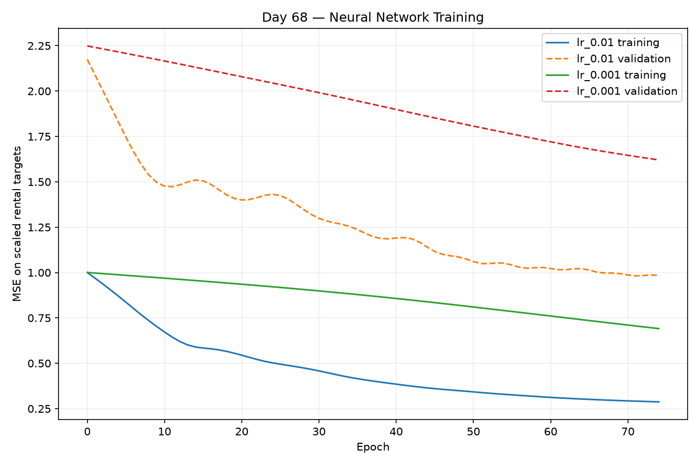

# PredictIQ — Day 68 PyTorch Neural Networks

## Objective

Learn and implement a small neural network
for historical hourly bike-rental regression.

## Architecture

Input features: 7

Input -> Linear(16) -> ReLU
      -> Linear(8) -> ReLU
      -> Linear(1)

Framework: PyTorch 2.15.0+cpu

Optimizer: Adam

Loss function: Mean Squared Error (MSE)

Training epochs: 75

## Data Split

Training: 12139
Validation: 2640
Held-out test: 2600

Feature and target scaling are fitted
using training data only.

The held-out test set was not evaluated.

## Actual Neural-Network Results

| Learning rate | Validation MAE | Validation RMSE | Initial training loss | Final training loss | Final validation loss |
|---|---:|---:|---:|---:|---:|
| 0.01 | 103.3344 | 151.1725 | 1.000408 | 0.287477 | 0.98396 |
| 0.001 | 139.7908 | 194.0205 | 1.000408 | 0.691311 | 1.620792 |

Selected learning rate:
0.01

This selection applies only to the
neural-network learning experiment.

## Comparison With Day 66

Our Day 66 Random Forest reference achieved:

Validation MAE: 47.68
Validation RMSE: 74.14

The neural network must not replace the Random
Forest unless evidence supports the change.

## Training Concepts

Forward pass:
Compute predictions using current model weights.

Loss:
Measure the difference between actual and predicted values.

Backward pass:
Calculate gradients using automatic differentiation.

Optimizer:
Update model weights to reduce training loss.

Epoch:
One complete training iteration over the training set
in this full-batch learning experiment.

Generalization:
Performance on data not used to fit the model.

## Training and Validation Curves

## Model Artifacts

Generated locally:

reports/generated/day68/tiny_network.pt
reports/generated/day68/report.json
reports/generated/day68/learning_curves.png

Model weights and scaling metadata are saved
locally, not committed to GitHub.

Only load model files from trusted sources.

## Reproduction

Install the project dependencies. On Windows,
the pinned CPU-only PyTorch wheel is available
through the PyTorch CPU package index:

    python -m pip install -r requirements.txt --extra-index-url https://download.pytorch.org/whl/cpu

Run:

    python -m src.predictiq.day68_neural

Test:

    python -m pytest tests -v

## Limitations

- Historical dataset from 2011-2012.
- Small neural network for educational purposes.
- Only two learning rates evaluated.
- Validation loss may differ substantially from training loss.
- Held-out test set remains unused.
- Modern forecasting accuracy is unverified.
- The production FastAPI and frontend are unfinished.

## Next

Day 69: Embeddings and transformer fundamentals.

Day 70: PredictIQ ML/FastAPI proof application.

## Dataset Credit

Fanaee-T, H. (2013).
Bike Sharing Dataset.
UCI Machine Learning Repository.
https://doi.org/10.24432/C5W894
